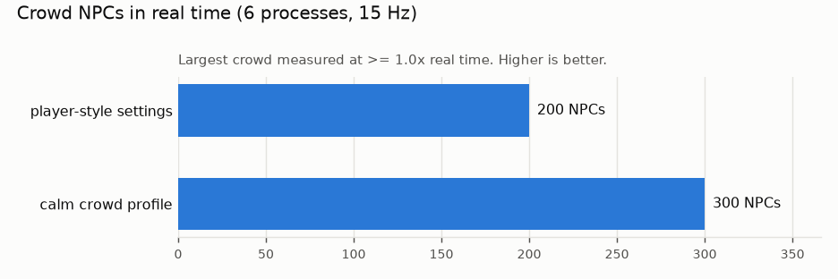

# coreml-motion-bricks

Run **NVIDIA MotionBricks** — real-time, AI-generated character animation — on an **Apple Silicon Mac**, with
the network on the **Apple Neural Engine** via CoreML. No NVIDIA GPU or TensorRT needed.

MotionBricks ([paper](https://research.nvidia.com/labs/gear/motionbricks/pdfs/motionbricks_siggraph_2026.pdf),
[code](https://github.com/NVlabs/motionbricks)) generates full-body motion between recent poses and target
poses: walking, running, crouching, style variations, and interactions such as jumping, vaulting and ducking.
NVIDIA's release runs on TensorRT. This project converts its SOMA (human) model to CoreML, fixes what breaks on
the way, and runs NVIDIA's own character runtime on top of it.


## At a glance (Apple M2 Pro, 16 GB, macOS 26)

* **Accurate**: matches NVIDIA's model on 84 recorded real generations; feet stay planted.
* **~10 ms per generation** on the Neural Engine (99% of the work there; the GPU stays free for rendering),
  vs ~27 ms with ONNX Runtime on the CPU.
* **~690 characters/s** Neural Engine throughput with batch-8 models.
* **~300 NPCs in real time** on a street with jump/duck obstacles; 200 with NVIDIA-style input settings.
* **Not for player characters (yet)**: ~0.4 s from input to visible motion, clips ≥ 0.8 s.

All numbers below were produced from a clean checkout with the commands shown, on one machine. Details, the
bugs found and what didn't work: [docs/findings.md](docs/findings.md).

## Evidence

### Speed


| Backend (batch 1) | Time per generation | Where the work runs (CoreML compute plan) |
|---|---|---|
| ONNX Runtime, CPU | 26–27 ms | CPU |
| CoreML, CPU + GPU | ~12 ms | GPU 89%, CPU 11% |
| CoreML, let CoreML choose (`ALL`) | — | GPU 86%, Neural Engine 13% |
| **CoreML, CPU + Neural Engine** | **~10 ms** | **Neural Engine 99%**, CPU 1% |

`python tools/motion_quality.py`, `python tools/bench_neural_engine.py`

### Throughput (for crowds)


| Model | 1 call at a time | 8 calls queued |
|---|---|---|
| batch 1 | 113 /s | 132 /s |
| batch 2 | 165 /s | 239 /s |
| batch 4 | 232 /s | 352 /s |
| batch 8 | 321 /s | **692 /s** |

Characters generated per second on the Neural Engine. `python tools/bench_neural_engine.py`

### Accuracy

Each converted model vs NVIDIA's model (rewritten as pure fp32) on 84 network inputs recorded from NVIDIA's own
runtime (walking, turning, running, both gym jumps). For scale, **NVIDIA's own fp16 ONNX model scores 0.008**
on the same test.

| Package | Neural Engine: mean \|Δ\| | same clip length | GPU: mean \|Δ\| |
|---|---|---|---|
| batch 1 | 0.0091 | 84 / 84 | 0.0091 |
| batch 2 | 0.0091 | 84 / 84 | 0.0071 |
| batch 4 | 0.0091 | 84 / 84 | 0.0078 |
| batch 8 | 0.0099 | 80 / 80 | 0.0069 |

`python tools/check_accuracy.py`

### Motion quality

The same scripted walk, turn and stop on each backend (side view of the steady walk):


| Backend | Planted-foot slide | Mean joint distance to ONNX Runtime |
|---|---|---|
| ONNX Runtime, CPU (reference) | 0.14 m/s | — |
| CoreML, Neural Engine | 0.15 m/s | 3.0 cm |
| CoreML, GPU | 0.15 m/s | 4.5 cm |

Foot slide = toe speed while within 6 cm of the ground (lower is better). `python tools/motion_quality.py`

### Crowds



| NPCs (6 processes, 15 Hz) | Settings | Real-time factor | Clips generated |
|---|---|---|---|
| 200 | NVIDIA / player-style | 1.06× | 1.58 per NPC per s |
| 200 | calm crowd profile | 1.36× | 0.97 per NPC per s |
| 300 | calm crowd profile | 1.06× | 0.97 per NPC per s |

Every NPC is a full NVIDIA character (state machine, obstacle interactions). Real-time factor ≥ 1 means the
crowd keeps up. `python -m cmb.crowd 200 300 --procs 6` (add `--player-style` for NVIDIA settings).


The browser demo draws every NPC with one instanced mesh whose bone transforms are computed in a vertex shader,
so the page costs ~0.05 ms of JavaScript per frame at 250 NPCs.

### Responsiveness

| | |
|---|---|
| Input → visible movement | ~0.4 s (NVIDIA's runtime; ~0.56 s with its default smoothing) |
| Shortest generated clip | 0.8 s (6 tokens), so a stop always plays out |
| Server step, one character | 1–3 ms per frame plus ~10 ms per generation |


### Is it a good fit?

| Use | Fit |
|---|---|
| Background NPCs, crowds, ambient characters | **Good**: ~300 on an M2 Pro, GPU left free |
| Offline animation generation, previs | **Good**: ~10 ms per clip, accurate |
| Player character in an action game | **Poor**: ~0.4 s response, clips commit ≥ 0.8 s |
| Shipping in a native app | **Possible, not done here**: needs the runtime ported from Python (Swift/C++) |

Not measured: power draw, other Macs (M1/M3/M4, base or Max chips), long-running stability beyond the
stress tests.

## Requirements

* Apple Silicon Mac, macOS 14 or later (tested on macOS 26)
* Python 3.12, Git LFS (`brew install python@3.12 git-lfs`)
* ~5 GB free disk (Python environment, model files, converted models)

## Quick start

```sh
git clone https://github.com/brookesdjb/coreml-motion-bricks.git   # not --recursive: setup.sh fetches
cd coreml-motion-bricks                                             # only the NVIDIA files it needs
./setup.sh                                   # venv + pinned NVIDIA checkout + model files (~0.5 GB from LFS)
.venv/bin/python -m cmb.convert              # build the CoreML models into build/ (~10-15 min)
.venv/bin/python tools/check_accuracy.py     # optional: verify against the fp32 reference
```

Then try a demo:

```sh
.venv/bin/python demos/course.py             # one character, keyboard control: http://localhost:8765
.venv/bin/python demos/crowd.py --npcs 250   # street crowd: http://localhost:8775
```

**Course** (WASD move, Shift run, C crouch, Q strafe, `[` style, E interact): NVIDIA's gym scene; the
character jumps, vaults, ducks and sits when it reaches the obstacles. **Crowd**: NPCs walk a street and take
on the obstacles; drag to orbit, scroll to zoom. The crowd takes a minute or two to start (workers load in
turn).

Headless crowd stress test:

```sh
.venv/bin/python -m cmb.crowd 200 300 --procs 6
```

## Using it in your own code

```python
from cmb.sim import Session
s = Session()                                   # NVIDIA's gym scene, CoreML on the Neural Engine
for _ in range(300):
    s.step(1 / 30, move=(0, 1), facing=(0, 1))  # walk +Y; jumps/vaults trigger at obstacles
    joints = s.world_joints()                   # (77, 3) world-space joint positions, Z up
```

`cmb.engine.MacSOMAEngine` is a drop-in for NVIDIA's `MotionBricksSOMAEngine` if you use their API directly.
Backends: `"CPU_AND_NE"` (default), `"CPU_AND_GPU"`, `"ALL"`, `"FP32:ALL"` (needs `cmb.convert --fp32`),
`"ort"`.

## Layout

| Path | |
|---|---|
| `cmb/convert.py` | ONNX → CoreML conversion with all fixes |
| `cmb/engine.py` | `MacSOMAEngine`: NVIDIA's engine with CoreML in place of TensorRT |
| `cmb/sim.py` | Headless NVIDIA character runtime (state machine, smart primitives) |
| `cmb/crowd.py`, `cmb/street.py` | Batched multi-NPC crowd, street scene, stress test |
| `cmb/_compat.py` | Import shims for NVIDIA's TensorRT/viewer dependencies |
| `demos/` | Browser demos (three.js) |
| `tools/` | Accuracy check, Neural Engine benchmark, batch-bug bisection |
| `third_party/motionbricks` | NVIDIA MotionBricks, pinned submodule (unmodified) |

## Limitations

* SOMA (human) model only; the Unitree G1 robot model isn't converted.
* Tied to the pinned MotionBricks commit: `cmb` subclasses and patches parts of NVIDIA's runtime.
* Response time (~0.4 s from input to visible motion, clips ≥ 0.8 s) suits NPCs better than a player
  character.
* NPCs don't avoid each other; only NVIDIA's obstacle interactions are used.

## Licence

Apache-2.0 for this project's code (`LICENSE`). NVIDIA MotionBricks code is Apache-2.0 / CC-BY-4.0, and its
models are under the NVIDIA Open Model Agreement — this repo doesn't redistribute models; see
[NOTICE.md](NOTICE.md). Not affiliated with or endorsed by NVIDIA.
