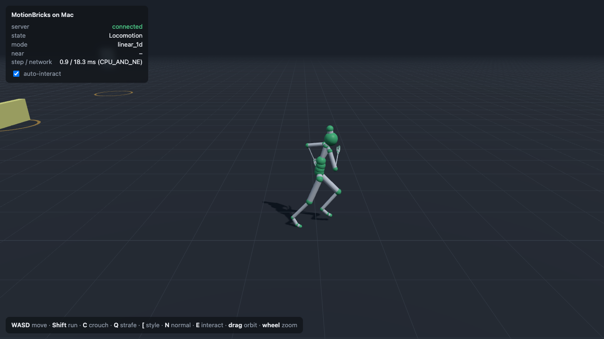
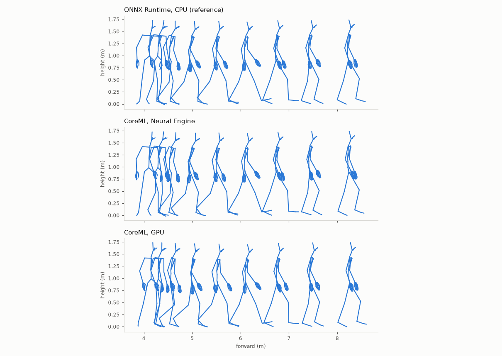
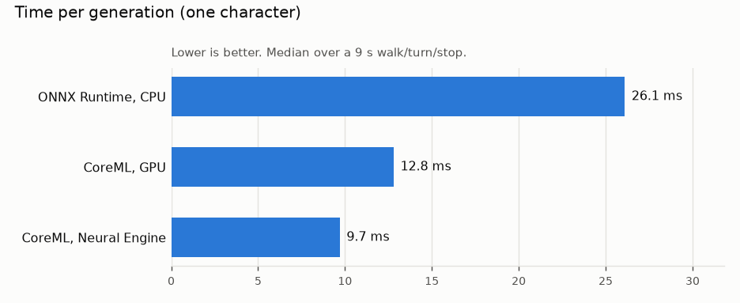
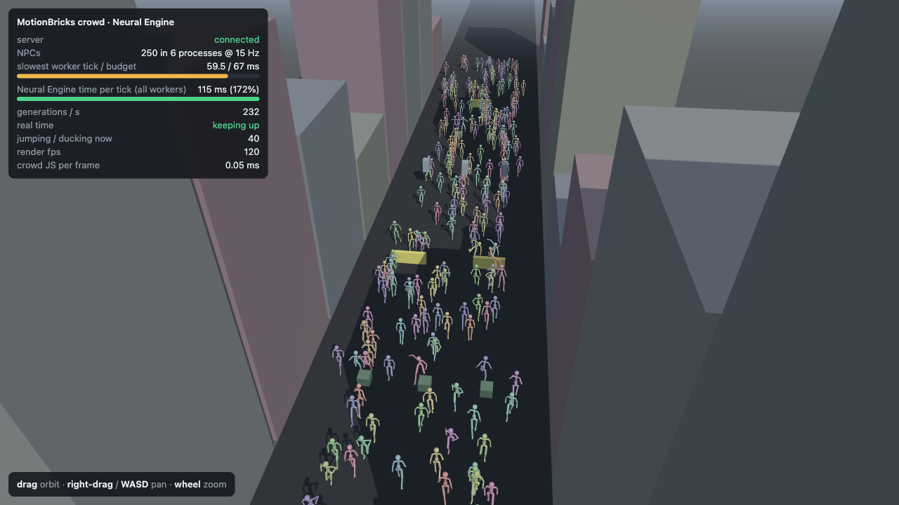
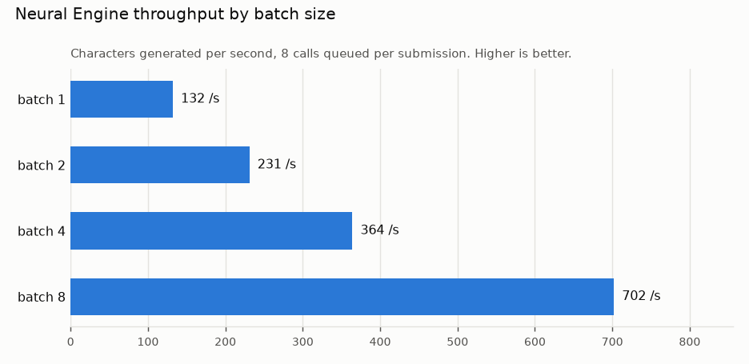
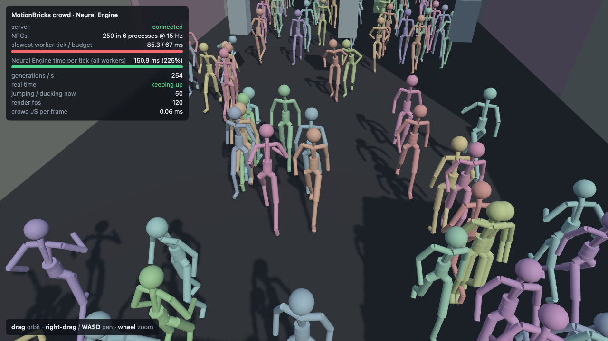

# coreml-motion-bricks

**NVIDIA MotionBricks on Apple Silicon.** A CoreML port that runs NVIDIA's real-time character animation model
on a Mac, with the network on the **Apple Neural Engine**. No NVIDIA GPU or TensorRT needed.

[MotionBricks](https://github.com/NVlabs/motionbricks)
([paper](https://research.nvidia.com/labs/gear/motionbricks/pdfs/motionbricks_siggraph_2026.pdf)) generates
full-body character motion between recent poses and target poses: walking, running, strafing, crouching,
style variations, and interactions such as jumping, ducking and sitting. NVIDIA's release runs on TensorRT.
This port **tracks the upstream project**: NVIDIA's code is a pinned, unmodified submodule; the same model is
converted to CoreML on your machine; and NVIDIA's own character runtime and example scripts run on top of it.
Only the network call changes.



## At a glance (Apple M2 Pro, 16 GB, macOS 26)

* **Feature parity**: all 14 features of NVIDIA's Scene Preview demo (locomotion modes, six styles, jumps,
  ducking, sitting) behave the same as with NVIDIA's reference model; NVIDIA's API examples run unmodified.
* **Accurate**: matches NVIDIA's model on 84 recorded real generations; feet stay planted.
* **~10 ms per generation** on the Neural Engine (99% of the work there; the GPU stays free for rendering),
  vs ~27 ms with ONNX Runtime on the CPU.

All numbers below were produced from a clean checkout with the commands shown, on one machine. Bugs found on
the way and what didn't work: [docs/findings.md](docs/findings.md).

## Compatibility with MotionBricks

Against the pinned upstream commit
[`54fc563`](https://github.com/NVlabs/motionbricks/tree/54fc563aeaaf819a753d72cc9fdc6713989cdd43) (23 Oct 2026):

| MotionBricks | On the Mac | How it was checked |
|---|---|---|
| SOMA (human) model | ✅ converted to CoreML | `tools/check_accuracy.py` vs the fp32 reference |
| Engine API (`MotionBricksSOMAEngine`) | ✅ drop-in `cmb.engine.MacSOMAEngine` | NVIDIA's examples below |
| `docs/examples/generate_once.py` | ✅ runs unmodified | `tools/run_upstream_example.py generate_once`: identical output on the Neural Engine and on ONNX Runtime (NVIDIA's model as published) |
| `docs/examples/locomotion_loop.py` | ✅ runs unmodified | `tools/run_upstream_example.py locomotion_loop`: same 14 generations; path within 1 cm of ONNX Runtime after 9 s |
| Scene Preview character runtime (locomotion modes, styles, smart primitives, auto-interact) | ✅ NVIDIA's runtime, headless | `tools/scene_preview_parity.py`: 14/14 features (below) |
| Scene Preview viewer | ⚪ replaced by a browser demo (`demos/course.py`) | NVIDIA's viewer needs Newton/OpenGL |
| Inbetweener, Scene Editor, Smart Primitive Editor apps | ⚪ not ported (viewer apps) | Their scene and smart-primitive files load and run |
| Unitree G1 robot model | ❌ not converted | |

### Scene Preview features

The same feature driven through NVIDIA's runtime with NVIDIA's default settings, on ONNX Runtime (NVIDIA's model
as published) and on the Neural Engine. Foot slide = toe speed while within 6 cm of the ground; lower is better.

| Feature | ONNX Runtime (reference) | Neural Engine |
|---|---|---|
| Walk forward | ✅ 0.13 m/s | ✅ 0.11 m/s |
| Run forward | ✅ 0.20 m/s | ✅ 0.23 m/s |
| Strafe | ✅ 0.21 m/s | ✅ 0.20 m/s |
| Crouch | ✅ 0.23 m/s | ✅ 0.19 m/s |
| Style: skipping | ✅ 0.23 m/s | ✅ 0.23 m/s |
| Style: vogue | ✅ 0.11 m/s | ✅ 0.10 m/s |
| Style: injured torso | ✅ 0.14 m/s | ✅ 0.13 m/s |
| Style: injured leg | ✅ 0.15 m/s | ✅ 0.14 m/s |
| Style: zombie | ✅ 0.09 m/s | ✅ 0.10 m/s |
| Style: combat | ✅ 0.11 m/s | ✅ 0.14 m/s |
| Jump (low wall) | ✅ | ✅ |
| Jump (high wall) | ✅ | ✅ |
| Duck under bar | ✅ | ✅ |
| Sit, then stand | ✅ | ✅ |

`python tools/scene_preview_parity.py [--backend ort]`

## Evidence

### Accuracy

Each converted model vs NVIDIA's model (rewritten as pure fp32) on 84 network inputs recorded from NVIDIA's own
runtime (walking, turning, running, both gym jumps). For scale, **NVIDIA's own fp16 ONNX model scores 0.008**
on the same test.

| Package | Neural Engine: mean \|Δ\| | same clip length | GPU: mean \|Δ\| |
|---|---|---|---|
| batch 1 | 0.0091 | 84 / 84 | 0.0091 |
| batch 2 | 0.0091 | 84 / 84 | 0.0071 |
| batch 4 | 0.0091 | 84 / 84 | 0.0078 |
| batch 8 | 0.0099 | 80 / 80 | 0.0069 |

`python tools/check_accuracy.py`

### Motion quality

The same scripted walk, turn and stop on each backend (side view of the steady walk):



| Backend | Planted-foot slide | Mean joint distance to ONNX Runtime |
|---|---|---|
| ONNX Runtime, CPU (reference) | 0.14 m/s | — |
| CoreML, Neural Engine | 0.15 m/s | 3.0 cm |
| CoreML, GPU | 0.15 m/s | 4.5 cm |

`python tools/motion_quality.py`

### Speed



| Backend (one character) | Time per generation | Where the work runs (CoreML compute plan) |
|---|---|---|
| ONNX Runtime, CPU | 26–27 ms | CPU |
| CoreML, CPU + GPU | ~12 ms | GPU 89%, CPU 11% |
| CoreML, let CoreML choose (`ALL`) | — | GPU 86%, Neural Engine 13% |
| **CoreML, CPU + Neural Engine** | **~10 ms** | **Neural Engine 99%**, CPU 1% |

`python tools/motion_quality.py`, `python tools/bench_neural_engine.py`

### Responsiveness

| | |
|---|---|
| Input → visible movement | about 0.5 s with NVIDIA's default smoothing; about 0.4 s with `demos/course.py --responsive` |
| Shortest generated clip | 0.8 s (6 tokens), so a stop always plays out |
| Runtime step, one character | 1–3 ms per frame, plus ~10 ms per generation |

These come from MotionBricks' design (it commits to believable clips), not from the port.

### Is it a good fit?

| Use | Fit |
|---|---|
| NPCs and ambient characters | **Good**: ~10 ms per clip, GPU left free (see the crowd experiment below) |
| Offline animation generation, previs, prototyping | **Good**: accurate, fast enough to iterate |
| Player character in an action game | **Poor**: ~0.4–0.5 s response, clips commit ≥ 0.8 s |
| Shipping in a native app | **Possible, not done here**: the runtime is Python; would need porting (Swift/C++) |

Not measured: power draw, other Macs (M1/M3/M4, base or Max chips), long-running stability beyond the
stress tests.

## Requirements

* Apple Silicon Mac, macOS 14 or later (tested on macOS 26)
* Python 3.12, Git LFS (`brew install python@3.12 git-lfs`)
* ~5 GB free disk (Python environment, model files, converted models)

## Quick start

```sh
git clone https://github.com/brookesdjb/coreml-motion-bricks.git   # not --recursive: setup.sh fetches
cd coreml-motion-bricks                                             # only the NVIDIA files it needs
./setup.sh                                   # venv + pinned NVIDIA checkout + model files (~0.5 GB from LFS)
.venv/bin/python -m cmb.convert              # build the CoreML models into build/ (~10-15 min)
.venv/bin/python tools/check_accuracy.py     # optional: verify against the fp32 reference
```

Run NVIDIA's own examples on the Mac:

```sh
.venv/bin/python tools/run_upstream_example.py generate_once
.venv/bin/python tools/run_upstream_example.py locomotion_loop
```

Or drive a character in the browser (NVIDIA's gym scene, NVIDIA's settings):

```sh
.venv/bin/python demos/course.py             # http://localhost:8765
```

WASD move, Shift run, C crouch, Q strafe, `[` cycle styles, N back to normal, E interact. The character jumps,
ducks and sits when it reaches the obstacles, as in NVIDIA's Scene Preview.

## Using it in your own code

With NVIDIA's engine API (as in their [Runtime API docs](https://github.com/NVlabs/motionbricks/blob/main/docs/runtime_api.md)),
swap the engine class:

```python
import cmb.engine                     # sets up imports for NVIDIA's code; CoreML instead of TensorRT
from cmb.engine import MacSOMAEngine  # in place of motionbricks.model.soma.engine.MotionBricksSOMAEngine
# to_runtime: the model-to-world transform, as in NVIDIA's docs/examples/_rig.py
engine = MacSOMAEngine("CPU_AND_NE", model_to_runtime=to_runtime)
# ... engine.create_input(...), engine.generate_animation(context, target, output) as in NVIDIA's docs
```

Or the headless Scene Preview runtime:

```python
from cmb.sim import Session
s = Session()                                   # NVIDIA's gym scene and settings, Neural Engine
for _ in range(300):
    s.step(1 / 30, move=(0, 1), facing=(0, 1))  # walk +Y; interactions trigger at the obstacles
    joints = s.world_joints()                   # (77, 3) world-space joint positions, Z up
```

Backends: `"CPU_AND_NE"` (default), `"CPU_AND_GPU"`, `"ALL"`, `"FP32:ALL"` (needs `cmb.convert --fp32`),
`"ort"`.

## Tracking upstream

* `third_party/motionbricks` is NVIDIA's repository as a git submodule at the tested commit, unmodified.
* What the port touches, all in this repo: `cmb/_compat.py` (stubs for TensorRT and the viewer packages),
  `cmb/engine.py` (a subclass of NVIDIA's engine that calls CoreML instead of TensorRT), and `cmb/convert.py`
  (ONNX → CoreML). The character runtime, smart primitives, scenes and clips are NVIDIA's.
* To try a newer MotionBricks: update the submodule, rerun `./setup.sh`, `python -m cmb.convert`, then
  `tools/check_accuracy.py`, `tools/scene_preview_parity.py` and the upstream examples. A change to the model's
  inputs/outputs or to `MotionBricksSOMAEngine` internals may need updates here.

## Experiment: crowds

Not part of MotionBricks: an experiment in how many independent MotionBricks characters a Mac can run. Every
NPC is a full NVIDIA character (state machine, obstacle interactions); generations are batched onto the Neural
Engine and NPCs are split over worker processes.



| NPCs (6 processes, 15 Hz) | Settings | Real-time factor | Clips generated |
|---|---|---|---|
| 150 | NVIDIA defaults | 1.23× | 1.58 per NPC per s |
| 200 | NVIDIA defaults | 1.01× | 1.58 per NPC per s |
| 200 | calm crowd profile | 1.36× | 0.97 per NPC per s |
| 300 | calm crowd profile | 1.06× | 0.97 per NPC per s |

Real-time factor ≥ 1 means the crowd keeps up. The *calm crowd profile* is this repo's addition, not
NVIDIA's: longer clips and less sensitive regeneration, which asks for ~40% fewer clips at the same foot slide.
Neural Engine throughput rises with batch size (`tools/bench_neural_engine.py`):



Batch sizes above 4 needed three Neural Engine workarounds in the conversion ([findings](docs/findings.md)).

```sh
.venv/bin/python demos/crowd.py --npcs 250        # http://localhost:8775 (workers take ~2 min to start)
.venv/bin/python -m cmb.crowd 200 300 --procs 6    # headless; add --nvidia-settings for NVIDIA's defaults
```



## Layout

| Path | |
|---|---|
| `cmb/engine.py` | `MacSOMAEngine`: NVIDIA's engine with CoreML in place of TensorRT |
| `cmb/convert.py` | ONNX → CoreML conversion with all fixes |
| `cmb/sim.py` | Headless Scene Preview runtime (NVIDIA's state machine, smart primitives) |
| `cmb/_compat.py` | Import shims for NVIDIA's TensorRT/viewer dependencies |
| `cmb/crowd.py`, `cmb/street.py` | Crowd experiment |
| `demos/` | Browser demos: `course.py` (one character), `crowd.py` |
| `tools/` | Upstream example runner, parity test, accuracy check, motion quality, benchmarks, batch-bug bisection |
| `third_party/motionbricks` | NVIDIA MotionBricks, pinned submodule (unmodified) |

## Licence

Apache-2.0 for this project's code (`LICENSE`). NVIDIA MotionBricks code is Apache-2.0 / CC-BY-4.0, and its
models are under the NVIDIA Open Model Agreement. This repo doesn't redistribute models; see
[NOTICE.md](NOTICE.md). Not affiliated with or endorsed by NVIDIA.
