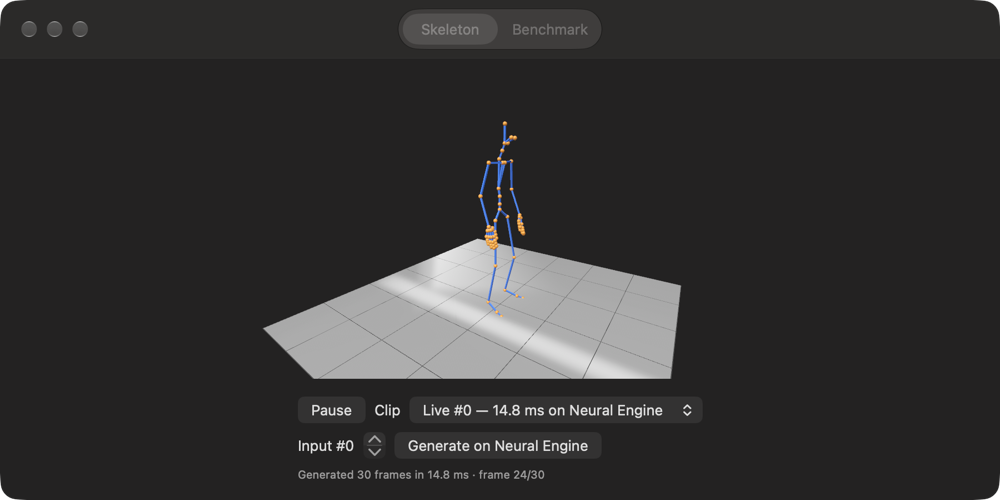

# Swift samples: MotionBricks SOMA on CoreML, natively

Two thin SwiftUI apps (macOS and iOS) over one shared Swift package. The main **Skeleton** tab plays
generated clips as a moving SOMA skeleton at 30 Hz, and can generate a fresh clip from a recorded input on
the Neural Engine and play it straight away. The **Benchmark** tab replays the 84 network inputs recorded
from NVIDIA's runtime and reports accuracy against the fp32 reference, time per call, decoded joint error,
and where CoreML places the work (Neural Engine / GPU / CPU).



## Layout

```
swift/
  MotionBricksKit/               shared Swift package (all the real code)
    Sources/MotionBricksKit/
      SOMAModel.swift            load .mlpackage/.mlmodelc with selectable compute units; typed predict + timing
      FeedSet.swift              reads the exported feeds (manifest.json + raw .bin tensors)
      Benchmark.swift            replay all feeds, mean |Δ| on valid frames, same-length count, median/p90 ms
      Placement.swift            per-op device preference and NE cost share via MLComputePlan
      PoseDecoder.swift          Swift/SIMD port of NVIDIA's pose decode + forward kinematics; parity check
      SkeletonView.swift         RealityKit skeleton player (+ DemoView: Skeleton and Benchmark tabs)
      BenchmarkView.swift        the benchmark tab
    Sources/mbbench/main.swift   command-line harness (same code path, no UI)
  Apps/Shared/MotionBricksApp.swift   the only app source; one #if os(macOS) block for locating files
  scripts/stage_ios_resources.sh      copies model + feeds into Apps/iOS/Resources for bundling
  project.yml                         XcodeGen spec -> MotionBricksSamples.xcodeproj (both app targets)
```

The model contract follows `cmb/convert.py` (`INPUT_NAMES`) and `cmb/engine.py` (`split_outputs`): seven
inputs (float32 values, int32 masks/token allowance), outputs picked by size — motion `[1, 64, 366]` (fp16
from the Neural Engine model) and `pred_num_tokens` `[1]`. Accuracy is computed as in
`tools/check_accuracy.py`: mean |Δ| over the first `4 × reference tokens` frames, OK if < 0.02 and ≥ 95 %
of clips choose the same length. Minimum OS: macOS 15 / iOS 18 (needed for `Float16` `MLShapedArray`).

## 1. Export the feeds (once)

Needs `build/feeds.npz` and `build/onnx/soma_fp32_b1.onnx` from the Python pipeline (`setup.sh` / convert).

```bash
.venv/bin/python tools/export_swift_feeds.py --out swift/Feeds
```

Writes 84 samples × 9 tensors (~11 MB) plus `manifest.json`. Use `--build /path/to/build` to read another checkout's `build/`.

Then the rig and the Python-decoded joint positions used for the skeleton and the parity check:

```bash
.venv/bin/python tools/export_swift_rig.py --feeds swift/Feeds
```

This writes `rig.json` (77 joints: names, parents, `pose_to_model`, reference local transforms,
`model_to_runtime`) and, for the first 8 samples, joint world positions decoded by NVIDIA's own Warp
kernels from the fp32 reference motion. (From a worktree without the submodule, prefix it with
`PYTHONPATH=/path/to/main/checkout` to use that checkout's `cmb` and `third_party`.)

## 2. Mac

```bash
brew install xcodegen   # once
cd swift && xcodegen generate && open MotionBricksSamples.xcodeproj
```

Run the **MotionBricksMac** scheme. On the Skeleton tab: drag to orbit, pinch to zoom, space to pause,
pick a clip, or choose an input and press **Generate on Neural Engine**. It looks for the model at `MB_MODEL`, else `build/coreml/soma_b1.mlpackage`
or `swift/Models/soma_b1.mlpackage` in the repo it was built from; feeds at `MB_FEEDS`, else `swift/Feeds` or
`build/swift_feeds`. "Choose…" buttons pick anything else. Pick compute units, press **Run**.
Set `MB_AUTORUN=1` to generate a live clip and start a benchmark run on launch (the summary goes to stdout).

Headless, same code:

```bash
cd swift/MotionBricksKit && swift run -c release mbbench ../../build/coreml/soma_b1.mlpackage ../Feeds ne gpu cpu
```

## 3. iPhone

The simulator has no Neural Engine (and CoreML there runs on the CPU), so its numbers mean nothing;
NE numbers need a real device.

1. Stage the model and feeds into the app bundle:
   `swift/scripts/stage_ios_resources.sh /path/to/build/coreml/soma_b1.mlpackage swift/Feeds`
2. `cd swift && xcodegen generate && open MotionBricksSamples.xcodeproj`
3. Select the **MotionBricksiOS** target → Signing & Capabilities → choose your Team, and change the
   bundle id (`com.example.motionbricks.ios`) to one you own.
4. Plug in the iPhone (A12 or newer, iOS 18+), trust the Mac, enable Developer Mode
   (Settings → Privacy & Security → Developer Mode), pick it as the run destination.
5. Use the **Release** configuration for timing (Product → Scheme → Edit Scheme → Run → Build Configuration),
   then ⌘R. Xcode compiles the `.mlpackage` to `soma_b1.mlmodelc` at build time; the first run then
   specialises it for the NE (several seconds, shown as "Load + compile").
6. Press **Run 84 recorded inputs** with "CPU + Neural Engine", then compare "CPU + GPU".

Simulator compile check: `xcodebuild -scheme MotionBricksiOS -destination 'generic/platform=iOS Simulator' build`.

## How the skeleton is decoded

`PoseDecoder` ports `decode_motionbricks_output_kernel` (`model/soma/kernels.py`) and `compute_world_poses`
(`utils/pose_utils.py`). Each of the 64 output frames is: global root [5], child joint positions [3×29],
global 6D rotations [6×30], velocities, foot contacts [4]. The decode drops 3 boundary frames at each end,
keeping `4 × tokens − 6` frames. It takes the hips position plus each model joint's 6D rotation
(Gram-Schmidt to a matrix), turns global rotations into parent-relative ones, keeps the skeleton's reference
bone offsets, fills the 47 joints the model does not predict (fingers etc.) from the reference pose, then runs
forward kinematics. The parity check applies `model_to_runtime` (Z up) as NVIDIA's engine does; the view
uses SOMA model space (Y up) and moves each clip's start above the origin.

Not ported, because they need the runtime's state rather than one network call: the heading **alignment**
from the context pose (identity here), the **endpoint deltas** that blend clip ends into context/target poses,
and the **controller** that stitches clips into continuous, steerable motion.

## Results so far (M2 Pro, macOS 27, Xcode 27.1, `build/coreml/soma_b1.mlpackage` from the ONNX route)

| Compute units | mean \|Δ\| | same length | median ms/call | p90 | placement (MLComputePlan) |
|---|---|---|---|---|---|
| CPU + Neural Engine (Mac app) | 0.0092 | 84/84 | 9.93 | 10.65 | 1570/2413 ops on NE, 843 CPU; **98.8 % of est. cost on NE** |
| CPU + Neural Engine (mbbench) | 0.0092 | 84/84 | 10.61 | 11.12 | same |
| CPU + GPU (mbbench) | 0.0100 | 84/84 | 12.84 | 13.57 | 2169 GPU, 244 CPU |
| CPU only (mbbench) | 0.0502 | 84/84 | 10.88 | 11.24 | 2413 CPU — over the 0.02 bar, so flagged MISMATCH |

Pose decode (`mbbench`, same numbers on the Benchmark tab):

| Check | mean | max |
|---|---|---|
| Swift decode vs NVIDIA's Python/Warp decode, same fp32 motion (8 clips, 324 frames, 77 joints) | 0.00035 mm | 0.0015 mm |
| Neural Engine output, decoded in Swift, vs Python decode of the fp32 reference | 8.6 mm | 97.7 mm |
| GPU output, decoded in Swift, vs Python decode of the fp32 reference | 2.0 mm | 15.3 mm |

So the port itself is exact to float precision. The Neural Engine's fp16 error grows along the joint chains
and is largest at the hands (up to ~10 cm), which is visible as slight finger jitter but not in the body.
Live generation in the app: ~15 ms per clip including Swift decode, after a warm-up call (the first call pays
a one-off ~30 ms). Timing in this run was noisier than the first (12 ms median on NE) because another session
was using the machine.

These match the Python/coremltools numbers (~9–11 ms, ~0.009). The CPU ops on the NE plan are mostly
cheap shape/cast ops (1.2 % of estimated cost). The CPU-only accuracy drop is worth a look if CPU fallback
ever matters. iOS: builds for the simulator; **no device numbers yet.**

## Not done / next steps

- **iPhone numbers** on a real device (steps above).
- **Rest of NVIDIA's runtime in Swift** (the pose decode is done) would involve:
  - the *controller* (`MotionBricksSOMAEngine` and its controller in `third_party/motionbricks`): building the
    seven inputs each step from the character state, keyframe/root targets and masks, choosing
    `allowed_pred_num_tokens`, and stitching generated clips into a continuous stream;
  - the remaining Warp kernels: pose *encoding* for the context/target inputs, heading alignment, and the
    endpoint-delta blending;
  - extending the parity harness to compare the full stitched motion with the Python runtime frame by frame.
- Skin a real mesh on the 77-joint skeleton (RealityKit skeletal animation) instead of spheres and boxes.
- Godot/Unreal plugins can reuse `MotionBricksKit` via a C shim, or call CoreML from Objective-C++.
- Check NVIDIA's model-weight licence before any commercial use.
